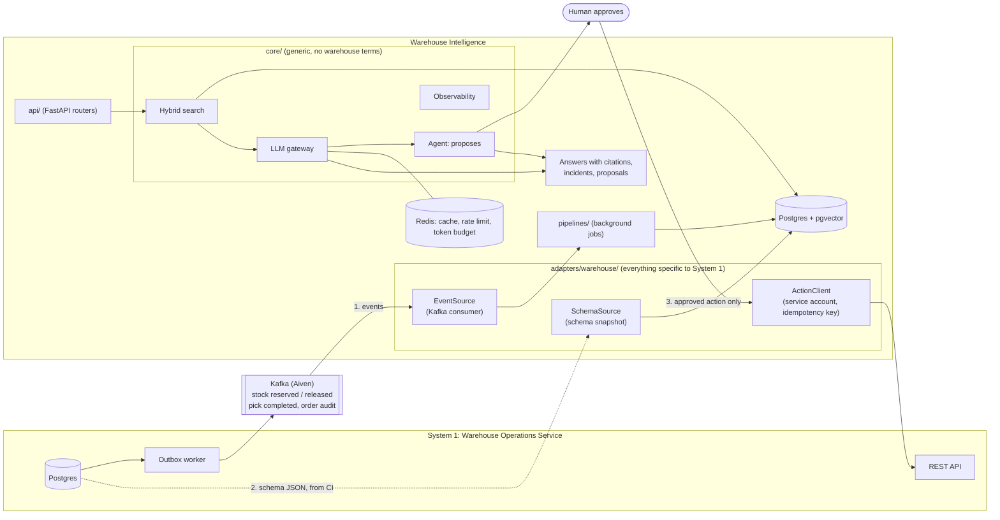

# Warehouse Intelligence

An AI layer that attaches to the Warehouse Operations Service (System 1) and makes it easier to understand, operate and debug. Not a chatbot on top of data: every answer will have a full trace, and its quality will be measured automatically.

The flow it is built for:
System 1 events → Kafka → index and projections → question or incident → answer with citations or a proposed action → human approval

**Status:** week 2 of 10. The repo skeleton is done (API with health checks, the local stack, tests and CI), and the Kafka event reader is built, with a duplicate check that handles each event once, but not yet run against a live broker. The AI modules come next (see Future Improvements).

## 🌐 Live Demo

- Not deployed yet. Planned on free tiers (Render, Vercel, Supabase, Aiven) in week 10.

---

## ✅ Key Capabilities

- Liveness and readiness endpoints: the API reports whether Postgres and Redis answer, within a timeout
- The whole local stack starts with one command: API, Postgres with pgvector, Redis, Prometheus, Grafana
- Runs side by side with System 1 on the same machine (different ports)
- Reads System 1's Kafka events and handles each one only once, even when Kafka delivers it again or a new consumer group replays everything
- A bad message never blocks the rest: unreadable messages and events whose handler keeps failing are kept in a dead-letter table with their error, and the reader moves on
- Every push is checked by CI: lint, format, tests (database tests on a real Postgres), the one-door boundary check and a Docker build
- One door to System 1: only one adapter file may call it, checked in CI

---

## 🧱 Tech Stack

**Backend**
- Python 3.11, FastAPI, SQLAlchemy 2 (async) with asyncpg, Redis, pydantic-settings
- aiokafka (Kafka consumer for System 1 events)
- PostgreSQL 16 with pgvector (vector search inside Postgres), schema managed with Alembic (versioned migrations)
- Docker (multi-stage image, non-root user) and Docker Compose
- Pytest (87 tests), Ruff (lint and format)
- GitHub Actions (CI)

**Observability**
- Prometheus and Grafana in the local stack

**Planned:** LLM gateway, LangChain, hybrid search, MCP, PyTorch and Transformers for an embeddings model

---

## 🚀 Features

### Built
- `GET /ops/live`: answers 200 without touching any dependency
- `GET /ops/ready`: checks Postgres and Redis at the same time, with a timeout; 200 when both answer, 503 naming the one that is down, and no error text that could expose hosts or passwords
- Local stack on 127.0.0.1 only, so nothing is reachable from the network
- Database settings passed as separate parts, so any password works
- Event reader: `EventSource` interface in `core/events.py`, with a Kafka implementation in `adapters/warehouse/`. It reads the 4 System 1 topics in its own consumer group (`KAFKA_GROUP_ID`, required, no default), checks every message against the event envelope (a time without a timezone counts as UTC), and marks a message done only after it has been handled. Connects to a local broker or to Aiven (SASL_SSL, settings from `KAFKA_*` environment variables)
- Each event handled once: `core/idempotency.py` records every event_id in the `processed_events` table, in the same transaction as the handler's writes, and skips an event it has already seen. The Kafka offset is committed only after that transaction commits
- Dead letters: `core/deadletter.py` keeps a message that cannot be read (broken JSON, a wrong or missing field, an empty tombstone) in the `dead_letters` table with its topic, partition, offset, raw bytes and error. A handler that fails is tried 3 times (waits of 0.5 s and 1 s), then its message goes there too. The offset is committed only after the dead letter is saved, and each Kafka position is kept once. When WI's database cannot be reached, the reader stops instead, so an outage does not turn every event into a dead letter

### Replays are safe
Kafka delivers at least once, so the same event can arrive again: a commit lost during a rebalance, or a new `KAFKA_GROUP_ID`, which starts from the earliest kept message and delivers every one of them again. `processed_events` makes both harmless: a repeated event_id is skipped, nothing is written twice, and its offset is still committed so the reader moves on. Changing `KAFKA_GROUP_ID` is therefore safe, only slower while the old messages are skipped.

### Planned modules
- **A. Warehouse Map:** live digital twins of zones, racks and orders
- **B. Process Topology:** a graph of what each action in System 1 really does
- **C. RAG Copilot:** questions answered with hybrid search and citations, safe text-to-SQL
- **D. Incident Inbox + agent:** detects problems, proposes a fix, a human approves before anything changes
- **E. Vector Space Explorer:** a visual map of the knowledge base
- **F. Quality Lab:** simulator, golden set and automatic evaluation of the answers
- **G. GenAI features:** free-text orders, a daily warehouse report with verified numbers

---

## 🎯 Design Decisions

- `/ops/ready` checks both Postgres and Redis, so a missing dependency shows up in seconds instead of as confusing errors later (D-001)
- Libraries and tool settings live in one `pyproject.toml`, installed with `pip install -e ".[dev]"` (D-002)
- Every local port binds to 127.0.0.1: Redis has no password, so nothing should be reachable from the network (D-004)
- The database URL is built from separate settings, so a password with `@` or `:` cannot break it (D-005)
- `core/` never imports `adapters/`: the AI parts stay generic, everything specific to System 1 lives in one place
- The core reads events through a generic `EventSource`; Kafka lives only in the adapter (D-009)
- A Kafka message is marked done only after it has been handled or saved as a dead letter, so nothing is lost silently (D-010)
- Dead letters keep the exact Kafka position and raw bytes, once per position; a failing handler gets 3 tries; a database outage stops the reader instead of filling the dead-letter table; the dead-letter store is passed to the event reader, so the generic `EventSource` interface did not change (D-018 to D-022)
- Every deployment and local run sets its own `KAFKA_GROUP_ID`, so a local run never takes messages from the deployed reader (D-012)
- Schema changes go through Alembic migrations with a working downgrade, on WI's own database only (D-013)
- The duplicate check wraps the handler, so its writes and the processed_events row are saved together or not at all, and the event reader holds no database code (D-014, D-015)
- Database tests use a separate local `wi_test` database and refuse any other address; CI runs them on a throwaway Postgres (D-016, D-017)
- System 1 is touched only through read channels (Kafka events, the schema, read endpoints) and one controlled write channel, used by the agent only after a human approves

Every decision, with the alternative not chosen: `docs/decisions.md`.

---

## 📊 Architecture Overview



Target design. Built so far: see Features > Built.

System 1 stays the owner of its data. WI reads it through events, a schema snapshot and read endpoints, never its database. The only write path back is `ActionClient`, after a human approves. `core/` never imports `adapters/`.

---

## 🧪 Running Locally

```sh
cp .env.example .env          # then set POSTGRES_PASSWORD and GRAFANA_ADMIN_PASSWORD to any local values
docker compose --env-file .env -f infra/docker-compose.yml up -d
.venv/Scripts/python -m alembic upgrade head   # creates WI's tables in the local wi database
curl localhost:8001/ops/ready # 200 when Postgres and Redis answer
docker compose --env-file .env -f infra/docker-compose.yml down
```

Ports avoid System 1 (5432, 8000): API 8001, Postgres 5433, Redis 6379, Prometheus 9090, Grafana 3000.

### Run tests
```sh
python -m venv .venv && .venv/Scripts/python -m pip install -e ".[dev]"   # bin/ instead of Scripts/ on Linux and macOS
.venv/Scripts/python -m ruff check . && .venv/Scripts/python -m pytest -q && .venv/Scripts/python tools/boundary_check.py
```

The database tests need a separate test database. Without one they are skipped locally (CI always runs them):
```sh
docker compose --env-file .env -f infra/docker-compose.yml up -d postgres
docker compose --env-file .env -f infra/docker-compose.yml exec postgres createdb -U wi wi_test
# then in .env: TEST_DATABASE_URL=postgresql+asyncpg://wi:<password>@localhost:5433/wi_test
```
The tests refuse any database that is not local or whose name does not end in `_test`, because they drop and recreate tables.

---

## ⚙️ CI

GitHub Actions on every push and pull request: `ruff check`, `ruff format --check`, `pytest` (with a throwaway Postgres service for the database tests), the boundary check, and a `docker build` of the image. No secrets and no LLM keys in CI.

---

## 📋 API Endpoints

| Method | Path | What it does | Who may call it |
|---|---|---|---|
| GET | `/ops/live` | The API process is up | Public |
| GET | `/ops/ready` | Postgres and Redis answer (200) or which one is down (503) | Public |

---

## 🧪 Testing Strategy

- 87 tests, run in CI on every push
- The readiness checks are tested with faked dependencies: no real Postgres or Redis needed
- The Kafka reader is tested with a fake consumer: valid and broken messages, commit only after the handler, no commit when the handler or parsing fails; no real Kafka needed
- The migration is tested up, down and up again, and the duplicate check runs on a real Postgres: first delivery, a repeated event skipped, a failing handler saving nothing, a replay through a new consumer group handling each event once
- The offset is committed only after the database transaction, checked with a fake engine that logs the order
- Dead letters: broken JSON, wrong fields and tombstones are saved and the reader moves on; a handler retried once, or dead-lettered after 3 tries; a database outage or a failed dead-letter write stops the reader with nothing committed; on a real Postgres, one row per Kafka position and a failing event dead-lettered while the next one is saved
- A test makes sure `core/` never imports `adapters/`
- Tests read `docker-compose.yml` and check every port binds to 127.0.0.1 and avoids System 1's ports
- The database URL is tested with passwords that contain `@`, `:` and `/`

---

## 🧠 What This Project Demonstrates

- Building an AI system on top of a real, existing system, without changing it to fit
- Clean boundaries: generic AI core, one adapter, one door to the other system
- Production habits from day one: health checks, CI, a non-root image, nothing exposed by default
- Decisions written down with their reasons and the options not chosen

---

## ⚠️ Limits

- No AI features yet: this is the week 1 skeleton
- `/ops/live` and `/ops/ready` are public, with no auth, like System 1's health ping
- The only tables are `processed_events` and `dead_letters`; migrations run by hand (`alembic upgrade head`), not at startup. `/metrics` is not built, so Prometheus scrapes only itself
- Library versions and image tags are not pinned yet
- The Kafka reader has not run against a live broker yet (planned with the week 2 integration test); there is no running consumer process and no handler that stores events yet (projections come later in week 2)
- Dead letters can only be read in the table: nothing replays them yet, and there is no alert or metric for them yet (planned for week 2 Sat)
- A database outage is recognised by its error: connection, network and pool-timeout errors, a dropped connection, or a Postgres error code of class 08 (connection), 53 (too many connections, no resources) or 57 (shutdown, still starting). Any other error counts as a bad event and goes to dead letters after 3 tries
- The reader dead-letters only when it is given the dead-letter store; nothing runs the reader with it yet (no consumer process until the week 2 projections)
- `processed_events` grows by one row per event and is never cleaned up yet

---

## 🔧 Future Improvements

- Week 2: Kafka ingestion and projections
- Week 3: digital twin and the warehouse map
- Week 4: process topology
- Week 5: indexing, hybrid search and the LLM gateway
- Week 6: copilot, router and safe text-to-SQL
- Week 7: incident inbox, agent and MCP
- Week 8: UMAP explorer and the Quality Lab simulator
- Week 9: evaluation, observability and security
- Week 10: deploy, demo
- Also: pin versions and image tags, protect `/ops/ready` before deploy, pass the Postgres user and database names to the API explicitly

---

## 👤 About

Built solo by **Razvan-Gabriel Dornea**, Backend Developer (Python/FastAPI), as the second project of a two-system warehouse platform, next to the Warehouse Operations Service.

- LinkedIn: [linkedin.com/in/razvan-gabriel-dornea-697579184](https://www.linkedin.com/in/razvan-gabriel-dornea-697579184/)
- GitHub: [@RazvanDRG](https://github.com/RazvanDRG)
